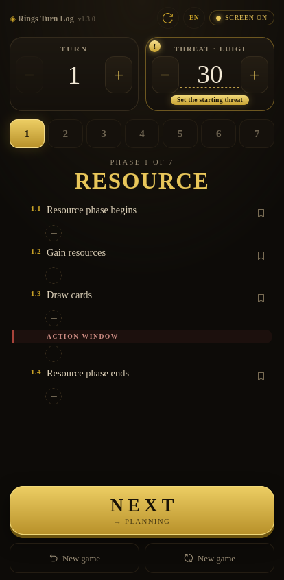

# Rings Turn Log

**Official app: <https://rings-turn-log.pages.dev/>**



A featherweight companion for **The Lord of the Rings: The Card Game**, built to
sit next to your playmat without getting in the way.

It keeps the turn and every player's threat in sight, walks you through all the
numbered steps of the seven phases, and takes care of the bookkeeping nobody
enjoys mid-game: the starting-threat reminder, the combat process pop-ups, the
quest progress maths, quick notes between steps and a single bookmark so you
never lose your place — even after the table gets wiped by a troll.

No account, no network, no tracking: one page you install from the browser and
use on the phone propped against the card box, or on a tablet in the middle of
the table. Interface in **Italian and English**, dark gold-on-black theme, and
it works offline.

## Features

- **Turn** and **Threat** (one per player) with `−` / `+` buttons (long-press to
  scroll fast).
- Tap the Threat number to set any value (default 30).
- Tap the player name to rename it, on phones and tablets alike.
- **Multi-player on tablet** (short side ≥ 600 px): up to **4 threat counters**,
  one per player, with custom names (minimum 1, maximum 4). On phones you get a
  single card for player 1.
- **Starting threat reminder**: on first launch and after “New game” the card
  pulses with a gold ring, shows a “!” badge and a “Set the starting threat”
  pill until you set the value (30 is just a default), one per player. Pressing
  NEXT or jumping to another phase counts the current value (30) as confirmed.
- **7-phase tracker** with every numbered rules step (1.1, 1.2, …) and
  **action windows** highlighted in red.
- **Combat processes in pop-ups**: “Resolve Enemy Attacks” and “Player Attacks”,
  opened from steps 6.4a and 6.8a.
- **Quest resolution (3.4)**: the pill under the step opens a pop-up with
  Willpower and Threat (`−`/`+` buttons, direct entry and long-press to repeat
  fast). If
  `Willpower − Threat` is zero or positive it shows the progress (with a
  **Close** button); if negative it raises every player's threat by that
  amount, with a visual effect, and the pop-up closes itself. After use it
  unlocks only with Undo; values reset at the next turn.
- **Single-step bookmark**: the ribbon next to each step marks one point at a
  time; the row is highlighted and a yellow dot appears on the matching phase in
  the stepper (combat processes mark phase 6). “New game” clears it.
- **Notes between steps**: the `＋` in every gap opens that gap's panel; notes
  show inline in purple and can be added, edited and deleted. They survive
  “New game” and are flagged by a purple dot on the stepper.
- **Bilingual IT/EN interface**: the top-right button toggles Italian and
  English (the choice is remembered). Phase names, processes, rules steps,
  history labels and pop-up texts are translated too. The initial language
  follows `?lang=`, then the saved preference, then the browser locale.
- **Phase names in the tablet stepper**: when there is room, buttons 1–7 show
  both the number and the phase name.
- **NEXT** advances the phase; from Refresh it starts the next turn (`Turn +1`,
  `Threat +1` for every player, back to Resource).
- **Threat turns red from 50**.
- **Undo** up to 30 steps: reverts mis-taps, phase changes, advances and even
  the reset.
- **Rotate the UI** with the `↻` button: switches between portrait and
  landscape, handy when the phone is propped up or mounted. The choice is
  remembered.
- **Screen wake lock on/off**: the top badge is a switch; the preference is
  saved.
- **Sounds**: `tap.mp3` on every button, `undo.mp3` when you undo,
  `new-round.mp3` when a new turn starts from Refresh, and `game-over.mp3`
  when a player's threat reaches 50 (once per crossing, also when the increase
  comes from Refresh or from the quest resolution).
- State, phase, bookmark, language, notes and history are stored in
  `localStorage` (key `rings-turn-log/v1`): reopen the app and find the game
  where you left it. Notes survive “New game”. Saves from the app's old name
  (`lotr-lcg-memo/v1`) are read and migrated automatically.
- **Installable, offline-first PWA** (manifest + service worker): works without
  a network after the first load. The version is shown next to the brand.

## Run locally

```bash
python3 -m http.server 8080
# then open http://localhost:8080
```

You need HTTP, not `file://`, otherwise the manifest and (in some browsers) the
wake lock won't work.

## Deploy to GitHub Pages

1. Create a repository and upload every file to the root of `main`.
2. Repository → **Settings** → **Pages**.
3. *Build and deployment* → Source: **Deploy from a branch** → Branch: `main`,
   folder `/ (root)` → **Save**.
4. After a minute the app is at `https://<user>.github.io/<repo>/`.

All paths are relative, so it works both as a “root” site and as a project
subfolder.

## Customization

Texts live in `i18n.js`, logic and structure in `app.js`, the version in
`version.js`:

- `version.js`: `self.APP_VERSION` is the single source of truth for the version
  shown in the app and for the service worker cache.
- `i18n.js`: the `it` and `en` dictionaries (phase names, processes, rules step
  texts, UI, history). Step keys are the stable ids used by notes and the
  bookmark.
- `FASI`: for each phase, its blocks built with `step("1.1")` and
  `actionWindow("w-1")`; the text comes from `i18n.js` via the id.
- `PROCESSI`: the two combat processes shown in the pop-ups (steps and action
  windows).
- `initialState()`: starting state (`turno: 1`, `fase: 0`, one player with
  `threat: 30` and `setup: false`, quest resolution at zero).
- `state.quest`: `{ willpower, threat, applied }` for the quest resolution; it
  is part of the undo snapshots.
- `PLAYER_LIMIT` (4) and `PLAYER_NAME_MAX` (18): maximum number of players and
  name length.
- `HISTORY_LIMIT`: how many undo steps to keep.
- `THREAT_ALERT`: threshold (50) above which the Threat turns red and the
  game-over sound plays once per crossing.
- `THREAT_MAX`: maximum settable Threat (999).
- `NOTE_LIMIT`: maximum length of a note (240 characters).
- `sfx`: audio files and volumes (`tap` 0.45, `undo` 0.7, `round` 0.9,
  `over` 0.9). The files `tap.mp3`, `undo.mp3`, `new-round.mp3` and
  `game-over.mp3` are in the project root.

## Players and tablet mode

- Tablet mode turns on by itself when the **short side** of the screen is at
  least **600 px**: it works in portrait, in landscape and with the UI rotated.
  Below that threshold the app is identical to the phone version.
- On tablets up to 4 threat cards appear (plus Turn), in a grid that wraps. The
  `＋` button adds a player (disabled at 4), the `×` removes one (only with at
  least 2).
- Tap the name to open the rename dialog; an empty name falls back to
  “Player N”.
- On phones only player 1 is shown, labelled “Threat · Name” when a name is
  set. The name is editable on phones too: tap the label to open the rename
  dialog.
- Data lives in `state.players`: `[{ id, name, threat, setup }]`. `setup` is
  the starting-threat reminder of each player.
- 1.0.0 saves (single `minaccia` field) are migrated automatically to the first
  player on first launch.

Notes are stored in the same `localStorage` document under `notes`, indexed by
container and gap: `"0::1.3"` = after step 1.3 of the Resource phase, `"0::end"`
= end of phase, `"proc:nemici::6.4.1"` = after 6.4.1 in the enemy attacks
process. Saves from the old format (notes per phase) are migrated automatically
to the end of the phase. Notes are not part of the game state, so “New game”
does not clear them and Undo does not touch them.

## Bookmark

- There is **one bookmark**: tap a step (number or text) or its ribbon on the
  right to mark it; tap the same step again to remove it, or another step to
  move it. The “Open the process” buttons do not trigger it.
- It works for phase steps and for combat process steps (6.4.x and 6.8.x); in
  that case the dot appears on phase 6.
- The marked row gets a gold bar; in the stepper the bookmark is the **yellow**
  dot at the bottom right, while notes stay the **purple** dot at the top
  right.
- It is saved in `state.bookmark` (`{ container, step }`), so it survives
  sessions; “New game” clears it and Undo restores it. Like notes, it does not
  take an undo slot.

## Quest resolution

- Step **3.4** has a **“Calculate progress”** pill that opens the resolution
  pop-up.
- **Willpower** accepts negative values (−999…999), **Threat** stays between 0
  and 999; both can be changed with `−`/`+` or by typing the number. Press and
  hold `−`/`+` to repeat fast, with the same timing as Turn and Threat.
- The result is `Willpower − Threat`:
  - **≥ 0**: shows the progress counter with its own icon (even 0) and, below
    it, the **Close** button;
  - **< 0**: shows “Raise threat by X”. The button raises the threat of **every**
    player by X, with a flash and `+X` on the visible counters, then **closes
    the pop-up itself**.
- After the increase the fields lock and the button stays disabled: the only way
  back is **Undo** (which restores threats and values) or a new
  turn/“New game”. Reopening the pop-up shows “Threat raised by X”.
- Values are saved in `state.quest` and create no history entry until the
  increase is applied.

## Language

- The top-right button shows the active language (`IT` or `EN`) and switches to
  the other one on tap; the choice is saved.
- Order at startup: `?lang=en` parameter (handy for testing), then the saved
  language, then `navigator.languages`, and finally Italian.
- English translations follow the rules terminology; to fix something, edit
  `i18n.js`.
- To add a language you need one entry in `self.I18N` and one in
  `self.I18N_LANG_NAMES`: the button includes it in the cycle automatically.

Styling (dark/gold theme) lives in `styles.css`, CSS variables in `:root`.

## Version, changelog and release cycle

Every release's changes are listed in [`CHANGELOG.md`](./CHANGELOG.md); below are
the rules for keeping it in sync with the version.

### Where the version lives

The version has a single source of truth: **`version.js`**

```js
self.APP_VERSION = "1.3.2";
```

From there:

- `app.js` shows it next to the brand (`Rings Turn Log v1.3.2`);
- `sw.js` uses it for the cache name (`rings-turn-log-v1.3.2`).

Do not write the version number anywhere else: change `version.js` and
everything else follows.

### Version numbers (Semantic Versioning)

- **MAJOR** (`2.0.0`): changes that break existing saves (`localStorage` format,
  notes, history) or radically change how the app is used.
- **MINOR** (`1.1.0`): new backwards-compatible features.
- **PATCH** (`1.3.3`): bug fixes and polish, no new features.

### When to bump the version

Bump it **on every release that changes cached files**: `index.html`,
`styles.css`, `app.js`, `version.js`, `manifest.webmanifest`, icons and audio.

The service worker serves those files from the cache: without the bump, a phone
with the app already installed may keep showing the old version.

It is not needed for changes only to `README.md`, `CHANGELOG.md` or
`.nojekyll`, which are not part of the precache.

### Release cycle

1. Finish the changes and test them locally (`python3 -m http.server`).
2. Bump `version.js` with the new number.
3. Add the entry in `CHANGELOG.md` (ISO date, `Added`, `Changed`, `Fixed`,
   `Removed` sections; move any `[Unreleased]` entries there).
4. Commit the changes on the working branch.
5. Bring them to the branch GitHub Pages publishes (in the setup above, `main`),
   for example with a merge from `develop`.
6. Create the **annotated tag** on the commit you want to publish, from the
   terminal:

   ```bash
   git tag -a v1.3.2 -m "v1.3.2"
   ```

7. Push commits and tag:

   ```bash
   git push origin main
   git push origin v1.3.2
   # or, if the branch is tracked:
   git push --follow-tags
   ```

8. On GitHub: **Releases → Draft a new release**, pick the tag you just pushed,
   paste the matching changelog section and publish. Pages redeploys the branch
   by itself.

The tag is created **locally** and pushed with `git push`: no special button
required. Alternatively you can create it from the UI:

- **GitHub**: Releases → *Draft a new release* → *Choose a tag* → *Create new tag*;
- **GitLab**: Repository → *Tags* → *New tag*, or Releases → *New release*.

In every case the tag must point **exactly at the commit being published**, and
must be annotated (`-a`) so it keeps author and message. To check: `git show
v1.3.2` and, in the app, the text next to the brand.

### Rollback

Never reuse a version number that has already been published: some browsers and
the service worker cache could confuse it with the old one.

To go back:

1. restore the code with `git revert` of the problematic commit (or start again
   from the previous tag with a new commit);
2. bump a **PATCH** (e.g. `1.3.3`);
3. add the entry in `CHANGELOG.md` and repeat the release cycle.

### Quick check

- Brand on top: it must show the version you just released.
- DevTools → *Application → Service Workers*: worker active.
- DevTools → *Application → Cache Storage*: a single cache,
  `rings-turn-log-v<version>`; caches from previous versions are deleted on
  activation.

## Install and offline use

- Serve the app over **HTTPS** (GitHub Pages works) or `localhost`: the service
  worker does not work from `file://`.
- On the first load HTML, CSS, JS, icons and audio are cached. From then on the
  app opens and works in airplane mode too.
- Android/Chrome: menu → “Install app” (or the automatic prompt). iOS/Safari:
  Share → “Add to Home Screen”.
- Updates: bump `version.js`; the installed app updates itself on reopening.
- If you change files locally and don't see the changes, bump the version or
  clear the site data.

## Notes on pop-ups and the keyboard

- Pop-ups open **at the top**, no longer centred.
- The overlay height follows the visible area (`visualViewport`): when the
  keyboard opens, the note field and the “Add” button stay above it.
- On short screens (landscape or rotated UI) the panel compacts and never spills
  outside its border; if the content still does not fit, the overlay scrolls.
- The same logic works with the UI rotated 90° (axes swapped).

## Notes on the wake lock

The top-right badge is a **switch**:

- **● Screen on** — lock acquired; a tap turns it off.
- **○ Screen off** — no lock; a tap turns it back on.
- **⚠ Not supported** — the browser does not expose the Screen Wake Lock API.

The preference is saved, so if you turn it off it stays off after a reload; if
it is on, it is reacquired automatically when you come back to the app. The wake
lock is supported by recent Chrome/Edge/Firefox and Safari 16.4+. On iOS you
should **add the app to the Home Screen** and open it from there: in many cases
it is the only way for the lock to work.

## Notes on rotation

- It rotates **the UI only**, not the system screen: the status bar and hardware
  keys stay where they are. It is the only option available from a web page (the
  Screen Orientation API only works in fullscreen on Android and does not exist
  on iOS).
- The button only switches between **portrait (0°) and landscape (90°)**; there
  are no upside-down rotations, which are useless with the phone propped up or
  mounted. Its icon shows the orientation you get by tapping: a landscape screen
  in portrait, a portrait screen when the UI is rotated.
- In landscape the logical width and height swap: the UI compacts to stay fully
  visible.
- The UI has a fixed height in every orientation: the phase stepper and NEXT do
  not move when descriptions or notes change; if the phase content is too tall,
  only that area scrolls. In landscape (logical heights under 480 px) the
  controls compact to stay visible, without making the page scroll.
- The chosen rotation is persisted in `localStorage`.
- UI sizes are computed in pixels from the viewport and realigned after
  fullscreen and orientation changes: on Android the viewport can update late
  and with `vw/dvh` units the rotated fullscreen UI could look “widescreen” with
  squashed phases.

## Notes on audio and fullscreen

- Browsers only allow audio after a user gesture: both the tap and the new-turn
  sound start from a touch, so they play correctly. If you hear nothing, check
  the phone volume and the silent switch.
- Effect volume is set in `app.js` (`sfx`); you can replace `tap.mp3`,
  `undo.mp3`, `new-round.mp3` and `game-over.mp3` keeping the same names. The
  Undo button uses only `undo.mp3`, without the generic tap on top.
- `game-over.mp3` fires once, when a player's threat goes from below 50 to 50 or
  more; staying above the threshold is silent, going back down and crossing it
  again plays it again. Undo never plays it, and neither does reopening the app
  with the threat already high.
- Fullscreen is **disabled**: the `⛶` button was replaced by the language
  selector. The markup is commented out in `index.html` and the code in
  `app.js` is guarded by `if (el.fullscreenBtn)`, so re-enabling it only takes
  removing the comment (and putting the button back in place of or next to
  `langBtn`). The Fullscreen API was applied to the page root, not to the
  rotated container, so rotation stayed active in fullscreen too.

## Structure

```
index.html
styles.css
app.js
i18n.js
version.js
sw.js
manifest.webmanifest
icon.svg  icon-192.png  icon-512.png
bookmark.svg  bookmark-filled.svg  pencil-1.svg  trash.svg
screen-portrait.svg  screen-landscape.svg  reset.svg  update.svg
cross-2.svg  plus.svg
enter-full-screen.svg  exit-full-screen.svg
willpower.png  threat.png  progress.png
tap.mp3  undo.mp3  new-round.mp3  game-over.mp3
screenshot.png
CHANGELOG.md
README.md
.gitignore
.nojekyll
```

UI icons are [Radix Icons](https://www.radix-ui.com/icons) (MIT): only the SVGs
actually used are in the root, while the full `icons/` folder is excluded by
`.gitignore`.
